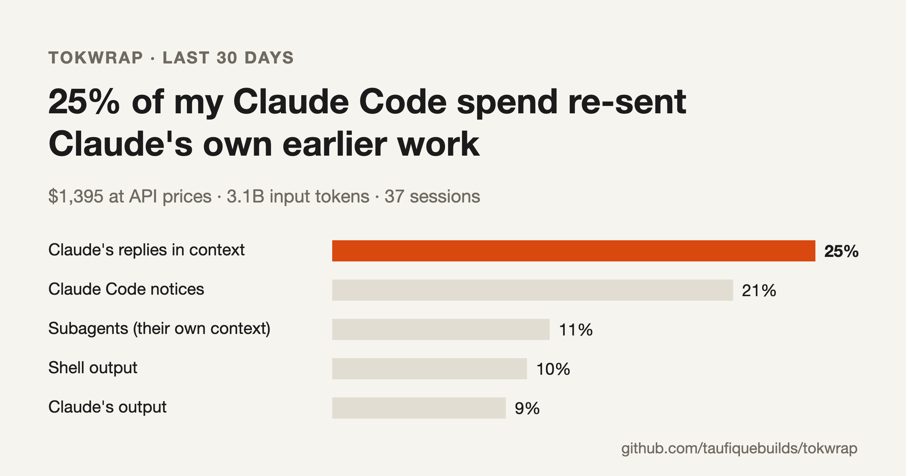

<div align="center">

# tokwrap

**See where your Claude Code tokens and money went, and what to change.**

[](https://github.com/taufiquebuilds/tokwrap/actions/workflows/ci.yml)
[](LICENSE)



</div>

Usage tools tell you *how much* you spent. tokwrap tells you *on what*: shell output, file reads, MCP tool lists, Claude Code's own notices, or Claude's earlier replies being sent again on every call. Then it tells you what to change, using your numbers.

```sh
pipx install tokwrap      # or: uvx tokwrap
tokwrap
```

It reads the logs Claude Code already keeps in `~/.claude/projects`. Nothing leaves your machine. No API key, no account, no dependencies beyond Python 3.9.

## What you get

```
tokwrap · last 30 days
37 sessions, 128 subagent runs, 8,345 API calls

  $1,395 at API prices    3.1B input tokens sent    10.1M output

Where it went
  ██████░░░░░░░░░░░░░░░░░░  25%    $345.86  Claude's replies in context
  █████░░░░░░░░░░░░░░░░░░░  21%    $286.78  Claude Code notices
  ███░░░░░░░░░░░░░░░░░░░░░  11%    $155.84  Subagents (their own context)
  ██░░░░░░░░░░░░░░░░░░░░░░  10%    $139.23  Shell output
  ██░░░░░░░░░░░░░░░░░░░░░░   9%    $124.22  Claude's output
  ██░░░░░░░░░░░░░░░░░░░░░░   8%    $110.29  File reads

  Claude Code notices, by kind:
      9%  $118.72  Tool list updates
      4%  $59.94  MCP server instructions

What to change
  1. Claude's own earlier replies and tool calls took $345.86, 25% of the total as they were
     re-sent. Long sessions carry everything forward: /clear between unrelated tasks and
     /compact before the context gets long.
  2. Tool lists and MCP instructions took 13%. Every time an MCP server connects, reconnects
     or changes, Claude Code adds its tool list to the conversation again. Turn off the MCP
     servers and plugins you don't use in this project (/mcp, /plugin).
  3. Shell output took $139.23, 10% of the total. ...
```

That is the author's real last 30 days, trimmed. The card at the top is the same data: `tokwrap --card card.png`.

## Why it's different

Every call to the model sends the whole conversation again. A 10,000-token command output that stays in a session for 200 more calls is sent 200 more times. It comes from the prompt cache, which is cheaper, but it is still billed and still counts against your limits. So the question isn't "how big was it" but "how big, times how many calls carried it". That's what tokwrap measures, for every block in every session.

## Options

```sh
tokwrap                     # last 30 days, every project
tokwrap --days 7            # a different window (0 = all time)
tokwrap --project myapp     # only projects whose folder name contains "myapp"
tokwrap --session latest    # one session: "latest", an id, or a .jsonl path
tokwrap --card card.png     # also save a share card (SVG, plus PNG if Chrome is installed)
tokwrap --json              # machine-readable output
```

## How it measures

- **Totals are exact.** Each API call in Claude Code's log records its input, cache and output tokens.
- **Sizes are measured, then split.** The growth in context between two calls is exact. When several blocks arrive in the same step (say, a tool result and a notice), that growth is split between them by length in characters. That split is the only estimate.
- **Cost is priced by type.** Cache reads, cache writes, plain input and output have different prices. tokwrap weights them with Anthropic's standard ratios (cache read 0.1×, 5-minute cache write 1.25×, 1-hour cache write 2×, output 5×), then scales each session to the cost Claude Code recorded for it. Sessions with no recorded cost use the rate of recorded sessions on the same model, and the report says how much was estimated that way.
- **Resumed sessions aren't counted twice.** Each API request is counted once, even when a resumed session copies its history into a new file.
- **On a subscription** (Pro or Max), the dollar figures are what the same usage would cost on the API. Read them as a share of your limits.

## FAQ

**Does it change anything?**
No. It only reads log files. The suggestions are for you to act on.

**Does it support Codex, Cursor or Gemini CLI?**
Not yet. Codex is next on the roadmap. Pull requests for other agents' logs are welcome.

**The numbers look different from ccusage.**
ccusage prices tokens from a price list. tokwrap uses the cost Claude Code itself recorded where it exists, and only counts calls inside the window. The breakdown is what tokwrap adds.

**What are "Claude Code notices"?**
Text Claude Code adds to the conversation for you: tool list updates when MCP servers connect, MCP server instructions, hook output, the skill list, and notes about files that changed. They are useful, but they are re-sent like everything else.

## Roadmap

- [ ] Codex CLI logs
- [ ] A `--compare` mode: this week against last week, to see if a change saved anything
- [ ] Per-project cards
- [ ] Suggestions that name the specific MCP server or command to change

## Contributing

The most useful contribution is a new "what to change" rule: a pattern in the logs that wastes tokens, and the fix. See [CONTRIBUTING.md](CONTRIBUTING.md).

## License

[MIT](LICENSE)
